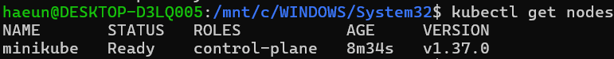
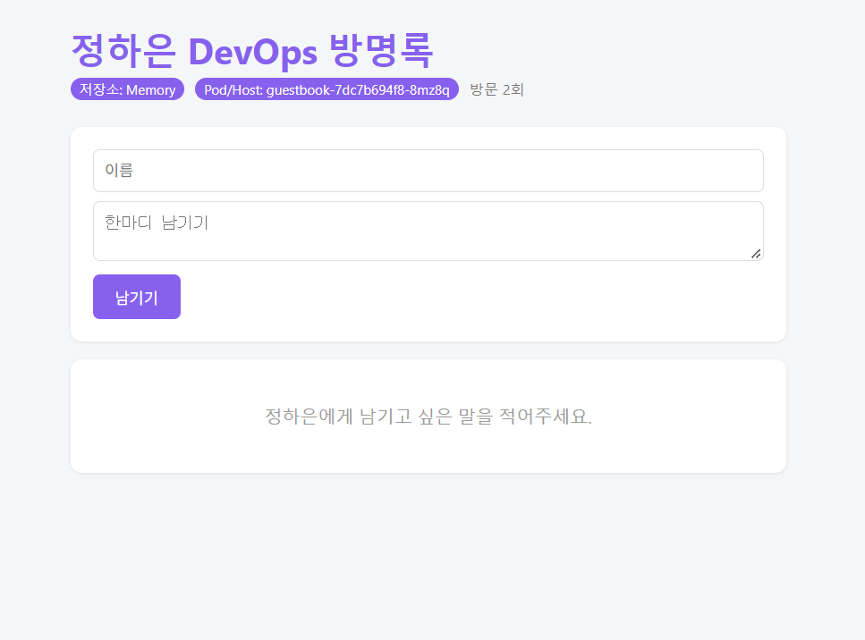

# 9주차 - Kubernetes 실습

## 1. 실습 환경
- Windows / WSL2 Ubuntu
- Docker Desktop
- kubectl / minikube

## 2. 실습 내용

### ① Kubernetes 클러스터 생성
kubectl과 minikube를 설치하고, 노드가 Ready 상태인지 확인하였습니다.

`kubectl get nodes`

### ② Pod 생성 및 자동 복구
nginx Pod를 생성한 후, Deployment를 이용해 Pod 3개를 실행하였습니다.

`kubectl create deployment mynginx --image=nginx --replicas=3`

Pod 하나를 삭제했을 때 새로운 Pod가 자동으로 생성되는 것을 확인하였습니다.

### ③ Pod 개수 변경
`kubectl scale` 명령어를 사용하여 Pod 개수를 5개, 2개, 3개로 변경하였습니다.

### ④ 방명록 애플리케이션 배포
기존에 제작한 방명록을 Kubernetes에서 실행하고, port-forward를 통해 브라우저에서 확인하였습니다.

## 3. 오류 및 해결

- **sudo 인증 실패:** WSL root 계정에서 Ubuntu 비밀번호를 재설정하였습니다.
- **kubectl 연결 오류:** Windows
