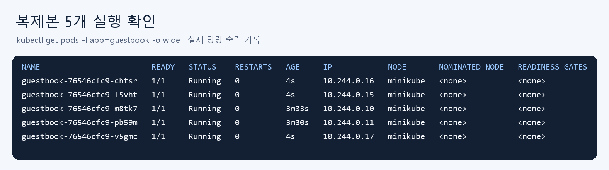

# Week10 - 쿠버네티스 배포와 서비스

- YAML로 Deployment와 NodePort Service를 배포했다.
- 복제본 4개로 확장해 요청 분산을 확인했다.
- v2로 업데이트한 뒤 v1으로 롤백했다.
- 최종 상태: v1, Pod 2개, NodePort 30080.

복제본 5개 실행 결과:



서비스에서 응답한 hostname:

- `guestbook-76546cfc9-m8tk7`
- `guestbook-76546cfc9-pb59m`

Pod `guestbook-76546cfc9-chtsr` 삭제 후 `guestbook-76546cfc9-pb5qm`이 자동 생성됐다.

rollout history:

```text
5  v2: title changed
6  v1: 롤백 완료
```
